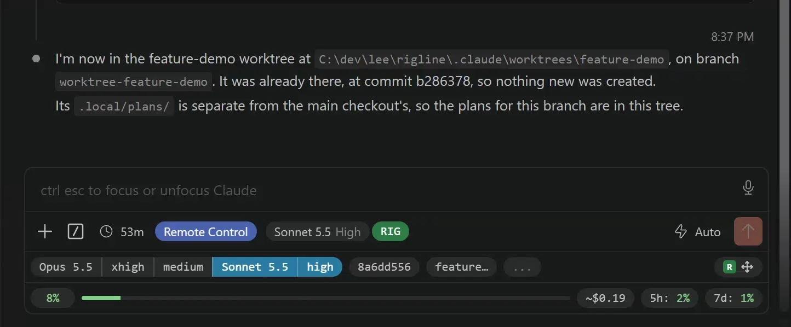
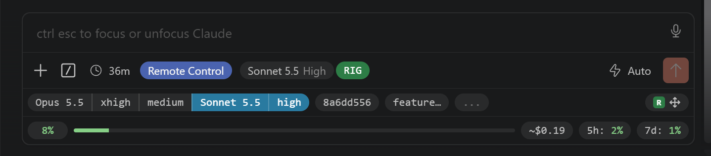

# Rigline

[](https://github.com/Rigline/Rigline/actions/workflows/ci.yml)
[](https://www.npmjs.com/package/rigline)

**Make Claude Code's VS Code panel your own.** Rigline builds on the panel Claude Code ships with
rather than replacing it, and lets you add to it, rearrange it and switch off what you don't need.
Out of the box it keeps your context size and your five-hour and weekly limits in view, puts your
favourite model and effort one click away, stamps the time on every step, and more. What it doesn't
do yet, a plugin can.

<p align="center">
  
</p>

    npm install -g rigline
    rigline install

Then *Developer: Reload Window* from the Command Palette. Rigline needs VS Code 1.90 or newer on
Windows, macOS or Linux, and Node 22.12 or newer. It puts itself back after each of Claude Code's
weekly updates, and `rigline restore` returns the extension to the bytes it shipped with.

> Rigline modifies Anthropic's extension, on your machine.
> [What it does and does not do](docs/anthropic-compliance.md): no credentials, no network calls
> from the panel, no rerouting of Claude usage. **If you are from Anthropic, please get in touch** —
> and if you would rather it stopped, it will.

## What you get

<p align="center">
  
</p>

These plugins come with Rigline, switched on:

- **[context-meter](plugins/context-meter/README.md)**: how full the context is, as a percentage and
  a bar, from the moment a session opens, turning yellow and then red as it nears compaction.
- **[usage-meter](plugins/usage-meter/README.md)**: what the session has cost, and your plan's
  five-hour and weekly limits, coloured by where each is heading at this pace.
- **[model-favourites](plugins/model-favourites/README.md)**: your usual model-and-effort
  combinations as one pill, a click each.
- **[time-marks](plugins/time-marks/README.md)**: the clock time on every tool call and thinking
  block, and a divider wherever the conversation paused or crossed a day.
- **[worktree](plugins/worktree/README.md)**: each session's tab prefixed with its worktree, so
  `ABCD-123 › Refactor the bus` tells it from the others at a glance.
- **[session-id](plugins/session-id/README.md)**: which session this panel is hosting, copied in
  full with a click.
- **[probe](plugins/probe/README.md)**: live self-tests of Rigline's plugin API.

Rigline itself adds *Diagnostics*, in the menu behind the `RIG` pill, which says whether all of it
is working. And it can
[make a new session ask which model to use](docs/config.md#choosing-a-model-before-you-send) before
it sends anything, since Claude Code keeps whichever model you last picked, in every session after.

## Make it yours

**Drag things around.** The move icon at the right of Rigline's row, or *Edit in place* under
*Layout* in the RIG menu, puts a handle on everything Rigline has placed. Drag one to any place its
plugin allows, onto *New row* to start another row, or onto the bar to switch it off; *Save* keeps
it. [docs/layout.md](docs/layout.md) has the rest, and the same from a terminal.

**Try a preset.** A preset is a whole layout in a file. *Presets* in the edit bar shows one before
you keep it, and `rigline layout export` saves yours to hand to somebody else:
[docs/presets.md](docs/presets.md).

**Change the settings.** *Settings…* in the RIG menu has a tab for Rigline and one for each plugin
with settings. All of it is one file, `~/.rigline/config.yaml`, which you can edit by hand and which
keeps your comments: [docs/config.md](docs/config.md).

**Add or drop plugins.** `rigline add` installs one from npm or a directory, `rigline disable NAME`
switches one off, the ones Rigline ships included, and `rigline list` names everything you have.

## Write your own

A plugin is one ES module and a manifest saying where its elements may go. This puts a pill in the
composer's footer:

```tsx
import { definePlugin } from "@rigline/plugin-api";
import { Pill } from "@rigline/plugin-api/ui";

export default definePlugin({
  setup(ctx) {
    return ctx.element("hello", () => <Pill>hello</Pill>);
  },
});
```

Claude Code updates about weekly, and its class names change with every build, so a plugin never
names one. It names an *anchor* — `footerSpacer`, `modelPill`, `transcriptRow` — and Rigline
resolves it against whichever version is installed. When an update moves something, the anchor is
repaired once, for every plugin, and anybody can apply the repair through one file without waiting
for a release ([docs/anchors.md](docs/anchors.md)). A plugin that needs something an update took
away is refused by name, never left half-working.

    npm create rigline-plugin my-plugin

[docs/authoring.md](docs/authoring.md) is the guide. A plugin has no network, no filesystem and no
code in the extension host, and [docs/plugin-policy.md](docs/plugin-policy.md) says what else is
asked of its author.

## What install does

The first `rigline` command you run fetches the engine, `@rigline/core`, into `~/.rigline/engine`
and runs it from there. `install` then puts Rigline's companion extension into every VS Code
profile that has Claude Code, and injects a small loader into every installed version of the
extension, keeping a byte-faithful backup of every bundle it touches. The reload starts the
companion, and the first install also patches the extension host, which only a window reload starts
again.

The companion is the part of Rigline that lives in VS Code. It re-injects after every Claude Code
update, saves what you change in the panel, and asks npm's registry for a newer engine each time a
window starts, moving to one once it is a day old. Putting it in needs VS Code's `code` command on
your `PATH`; on macOS, add it with *Shell Command: Install 'code' command in PATH* from the Command
Palette.

`rigline update` brings the engine and every plugin you installed from npm up to date, and
re-injects behind both. Every command that injects also puts the companion into any profile with
Claude Code that lacks it, and brings it up to date where it is behind.

## Where it works

VS Code 1.90 or newer on Windows, Linux and macOS, in a local window, with Node 22.12 or newer.

**Not supported yet:** remote windows, other editors built on VS Code, a portable VS Code, and a
custom extensions directory. In any of them, Claude Code's panel stays as it ships.
[docs/support.md](docs/support.md) lists each, and how to ask for one.

## If the panel goes blank

`rigline restore` puts every installed version back to the bytes the extension shipped with. It
needs nothing but Node: not VS Code, not a working extension, and not this repository.

Rigline then stays out, however often the window reloads or Claude Code updates, until you put it
back: the companion does not undo a restore. To find what blanked the panel, switch off the plugin
you suspect with `rigline disable NAME`, which puts the rest back, or run `rigline install` for all
of them.

If `rigline` itself is gone or will not run, the undo is a file copy, because the backup of every
bundle sits beside the bundle it came from. First make an empty file at `~/.rigline/restored`: it is
what tells the companion Rigline is meant to be out, and without it the companion puts Rigline back
at the next window. Each installed version is a directory under `~/.vscode/extensions/` named
`anthropic.claude-code-<version>-<platform>`, such as `anthropic.claude-code-2.1.283-win32-x64`,
and there may be more than one — do all of them, then reload the window.

    touch ~/.rigline/restored
    cd ~/.vscode/extensions/anthropic.claude-code-<version>-<platform>
    cp webview/index.js.orig webview/index.js
    cp extension.js.orig extension.js          # only if this file is there

The first is the one that matters: `webview/index.js` is what renders the panel.
`extension.js.orig` exists only where a plugin patched the extension host, and there is nothing to
undo when it is absent.

Failing all of that, uninstalling and reinstalling Claude Code from the Extensions view replaces
both files with the originals.

## Uninstalling

    rigline uninstall

It restores every installed version, takes the companion out of every VS Code profile, and then
says what is left to you, in order: reload every VS Code window, `npm uninstall -g rigline`, and
delete `~/.rigline`, which holds your settings, any plugin you added, and the engine. Reload before
deleting: a companion still running in a window that has not reloaded is kept out by a file in
`~/.rigline`.

## More

Rigline is stable: within 2.x, a plugin, a file you wrote and a command you scripted keep working,
as [docs/stability.md](docs/stability.md) describes.

- [docs/support.md](docs/support.md): where Rigline works, and asking for somewhere it does not yet.
- [SECURITY.md](SECURITY.md): reporting a vulnerability, or a plugin breaking the plugin policy.
- [CONTRIBUTING.md](CONTRIBUTING.md): building Rigline and running it against your own editor, with
  [docs/architecture.md](docs/architecture.md) as the map.
- [CHANGELOG.md](CHANGELOG.md): every release, for all four packages.

Named for the line a rigger threads through gear that's already built and standing, to add
something new without touching the rigging itself.

MIT.
