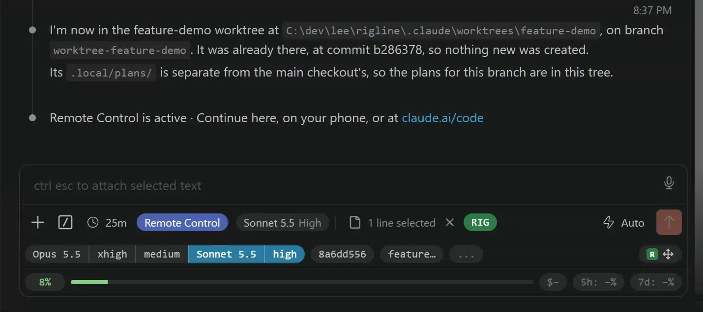

# Arranging the panel

Everything Rigline puts in Claude Code's panel — a pill in the composer's footer, a meter in the
rows under it — is an *element*, and you decide where each one goes. Drag it there in the panel,
write it in `~/.rigline/config.yaml`, or move it with `rigline layout`: all three change the same
file.

  

## In the panel

**Start editing** with the move icon at the right of Rigline's row, or *Edit in place* under
*Layout* in the menu behind the `RIG` pill. While you edit, every element has a handle over it, even
one with nothing to show at the moment, which shows its name instead. Rigline's rows all show, empty
or not, with *New row* below the last. A bar above the composer holds a tray of the elements that
are switched off or have nowhere to go in this panel, then *Presets*, *Reset to defaults*, *Save*,
*Revert changes* and *Done*.

**Move an element** by dragging its handle. The places it can go are outlined, and a marker shows
where it will land: elsewhere in its row, another row, the right of any row, *New row* to start
one, or the bar to switch it off. Drag one out of the tray to put it somewhere. The right of a row
is for something you want at its right edge with the space between left empty.

Or click a handle, or press Enter on it, for its moves as a menu: *Move before* and *Move after*
its neighbours, *Move to the right*, *Move to a new row*, *Switch off*, and *Plugin default*, which
puts it back where its plugin puts it. The arrow keys go from handle to handle, so the keyboard
reaches every move a drag does.

**Reorder rows** by the handle at each row's end, once there are two: drag it, or click it for
*Move row up* and *Move row down*. A row goes when nothing is left in it, and the rows number from
one again after every move.

**Nothing is written until *Save*.** It writes `config.yaml` through Rigline's companion extension,
keeping your comments, shows *Saved.* for a moment, and stops editing. *Revert changes* drops
everything since the last save, and with nothing unsaved it reads *Reload*, which picks up a layout
saved from another panel or a terminal. *Reset to defaults* puts back the layout Rigline starts
with, unsaved, so *Revert changes* still undoes it. *Done*, or Escape, stops editing and keeps what
you have not saved; the *Layout* menu says so, and its *Save* still keeps it.

A Ctrl-click on the move icon, Cmd-click on a Mac, reloads the saved layout instead of editing. If
a newer layout has been saved somewhere else while you have unsaved changes, the icon turns the
theme's warning colour and its tooltip says so.

The *Layout* menu works without editing in place too. It lists every element by where it is, each
with the same moves, and *Save* and *Reload saved layout* at the foot. The menu stays open while
you move things, so the panel behind it is the preview.

## In the file

The layout is the `layout` key of [`~/.rigline/config.yaml`](config.md):

    layout:
      rigRow:
        - session-id/address
        - session-id/full-id
      off:
        - session-id/short-id

Each key is a place, and under it are the elements you have put there, in the order you want them,
each named `plugin/element`. A place is one of:

- `rigRow`, Rigline's row at the foot of the composer box, and `rigRow 2`, `rigRow 3` and on, more
  rows below it. A row is only there while something is in it.
- `rigRow right`, `rigRow 2 right` and on, the right side of each row, for something you want at
  its right edge with the space between empty. A row's own name is its left side.
- `before`, `after` or `inside` one of the app's controls, by its anchor name: `before footerSpacer`
  is the composer footer, beside Rigline's own pill.
- `off`, for an element you do not want to see.

The panel names these as it shows them: *Rigline row 2, right* is `rigRow 2 right`, and *Footer* is
`before footerSpacer`.

An element can only go where its plugin allows, and one that can go in `rigRow` can go on either
side of any row. A plugin that puts something in `rigRow` puts it on the left of the first. Rows show
in number order, so `rigRow` and `rigRow 3` with nothing in `rigRow 2` are two rows; editing the
layout in the panel numbers them from one again.

    layout:
      rigRow:
        - session-id/address
      rigRow right:
        - rigline/edit
      rigRow 2:
        - context-meter/bar

When a row is too narrow for both sides, its left side wraps first, and the right side moves to a
line of its own only when there is no room for it beside the left, still at the right edge.

Leave an element out and it stays where its plugin puts it, and so does everything a plugin you
install later brings. In a place, the elements you list come first, in your order, and anything else
that belongs there follows.

Rigline's own two elements are named like any other: `rigline/edit`, the move icon, which starts
editing in place, and `rigline/reload`, which picks up the saved layout and starts off. A
Ctrl-click or Cmd-click on either does what the other does, so you need only the one you prefer.

Rigline starts you with a layout. Until a command first creates this file, Rigline reads it as if the
layout were already there, and the new file starts with it:

    layout:
      rigRow:
        - model-favourites/favourites
        - session-id/short-id
        - worktree/short-name
        - session-id/address
      rigRow right:
        - rigline/edit
      rigRow 2:
        - context-meter/percent
        - context-meter/bar
      rigRow 2 right:
        - usage-meter/cost
        - usage-meter/five-hour
        - usage-meter/seven-day

It names only the plugins Rigline ships, so a plugin you add puts its elements where its author
chose. `rigline layout reset`, or *Reset to defaults* in the panel, puts this layout back. For every
element where its plugin puts it instead, write `layout: {}`.

An entry that does not work — a misspelt place, a plugin you have removed, a place its element cannot
go — is named by `rigline install` and `rigline check`. The element stays where its plugin puts it,
and the entry stays in the file, so a plugin you remove and add back finds its place waiting. An
element listed under two places goes to the first, and the second is reported.

## From a terminal

`rigline layout` lists every element by place, marks those your layout put there, and says where
else each may go: the other side of its row, the other rows on the side it is on, and a new row.

    rigRow
      session-id/address   Messaging address  yours; can also go in rigRow right or in rigRow 2
      session-id/full-id   Full session id    yours; can also go in rigRow right or in rigRow 2
    off
      session-id/short-id  Session id         yours; can also go before footerSpacer, in rigRow or in rigRow 2

Each of these edits the file and re-injects, so the change is one reload of the panel away:

    rigline layout place session-id/address rigRow           # to the end of that place
    rigline layout place session-id/full-id rigRow 2         # a second row
    rigline layout place rigline/edit rigRow right           # at the first row's right edge
    rigline layout place session-id/short-id off
    rigline layout place session-id/short-id default         # back where its plugin puts it
    rigline layout order rigRow session-id/full-id session-id/address
    rigline layout reset                                     # the layout Rigline starts with

A place of more than one word, like `before footerSpacer` or `rigRow 2 right`, needs no quotes.
`order` replaces what you have listed in that place; an element you leave out of it goes back where
its plugin puts it.

## Presets

A layout you want to keep, swap between or hand to somebody else is a *preset*: `rigline layout
export` saves yours as a file, `rigline layout apply` puts one in place, *Presets* in the edit bar
shows one before you keep it, and Rigline ships a few. [presets.md](presets.md) is the whole of it.
