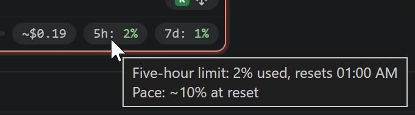

# usage-meter

What the session has cost and how much of your plan is used: three pills in the row under the
composer's controls.

  

## What it shows

- **Session cost**: Claude Code's own estimate of what this session has cost so far, the figure
  `/cost` reports. It is priced the way Claude Code prices it: cache reads and writes at their own
  rates, web searches, and an organisation's own rates where it has them. With more than one model,
  the tooltip gives each one's share.
  - *at managed rates* after the total means an organisation's own rates apply.
  - *(main model's price)* after a model means Claude Code had no price for that model and charged
    it at the main model's.
- **On a claude.ai plan** the figure is the list price of what the session used, not what you pay,
  so it reads `~$1.23`. With an API key, Console or a cloud provider it reads `$1.23`.
- **The five-hour and weekly limits**: `5h: 42%` and `7d: 18%`, the same windows the panel's own
  *Account & usage* bars show. The number is how much is used now. The colour is where the window
  is heading at this pace: green, then yellow once it is heading past 80%, then red once it would
  run out before it resets. Until a tenth of the window has gone, the colour follows what is used
  instead, since a burst at the start says little.
  - The tooltip gives the reset time.
  - *Pace: ~60% at reset* is where the window will be when it resets, at the rate it has been used
    so far. *Pace: runs out before reset* means that rate reaches the limit first.
  - *reset* means the window's time is up, and the next request starts a new one.
- **A dimmed `$–` or `–%`** while there is nothing to show yet.
  - The cost is unknown in a panel until a turn there carries cost data, which a reload starts
    over.
  - Claude Code reports the limits only on a claude.ai plan, after a request.
- With an API key or a cloud provider there are no plan limits, so the two limit pills do not
  appear.

Each is an element, so it can be moved or switched off from Rigline's menu or with `rigline
layout`. All three also fit in the composer footer.

## When it changes

- **The cost moves when a turn finishes**, so a long turn shows the last one's figure until it
  ends. It falls on `/clear`, and a resumed session continues from what Claude Code saved for it.
- **The limits move when Claude Code next hears from Anthropic**, which is after each request in
  any panel, and a window resets on time.

## What it depends on

- **`cost: true`** (required): `ctx.onSessionCost`, which the host reads from each turn's result.
- **`limits: true`** (optional): `ctx.onUsageLimits`, which the host reads from the usage windows
  the extension sends every panel. Without it the limit pills stay dimmed, and the cost pill still
  works.

How both are derived is D129 in `docs/decisions.md`. Rigline asks Claude Code for none of it: both
are messages the panel already receives.
